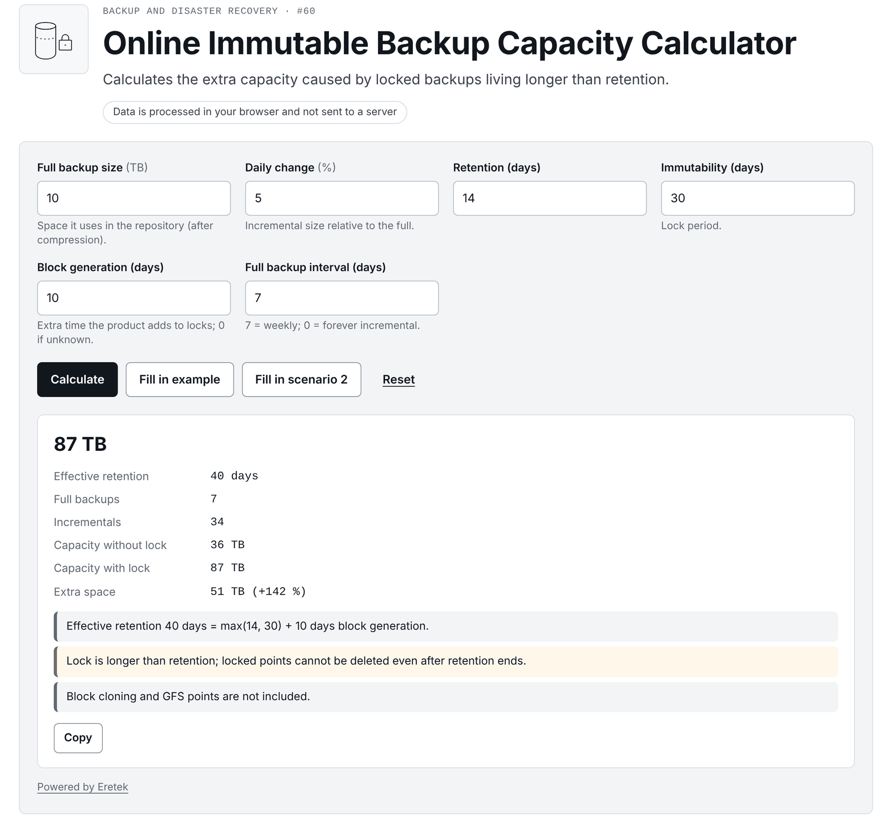

# Immutable Backup Capacity Calculator

Calculate the effect of immutability period and block generation headroom on repository capacity; extra space needed compared with normal retention.

## Try it live

- [Türkçe](https://sistem.eretek.com/araclar/immutable-backup-kapasite)
- [English](https://sistem.eretek.com/en/tools/immutable-backup-capacity)
- [Deutsch](https://sistem.eretek.com/de/werkzeuge/immutable-backup-kapazitaet)



## What it does

Calculates the extra capacity caused by locked backups living longer than retention.

An immutable backup against ransomware cannot be deleted before its lock expires. If the lock is longer than retention, or the product extends locks by a 'block generation' period, the repository must be noticeably larger than a normal calculation. The tool compares locked and unlocked scenarios.

## Where it helps

The lock should be at least as long as the time to detect ransomware. Compare capacity with the RAID and Backup Repository tools; mark the immutable copy in the 3-2-1-1-0 check.

## How to use it

1. Enter full backup size (after reduction), daily change and retention.
2. Enter the immutability period and your product's block generation headroom (10 days typical for Veeam).
3. Enter the full backup interval (0 = forever incremental) and press Calculate.

### Fields

| Field | Description |
|---|---|
| Full backup size | Space it uses in the repository (after compression). |
| Daily change | Incremental size relative to the full. |
| Retention (days) |  |
| Immutability (days) | Lock period. |
| Block generation (days) | Extra time the product adds to locks; 0 if unknown. |
| Full backup interval (days) | 7 = weekly; 0 = forever incremental. |

## Example input

Press **Fill in example** in the tool to load this input.

| Input | Value |
|---|---|
| Full backup size | `10` |
| Daily change | `5` |
| Retention (days) | `14` |
| Immutability (days) | `30` |
| Block generation (days) | `10` |
| Full backup interval (days) | `7` |

**Expected result:** Effective retention 40 days: 7 fulls + 34 incrementals = 87 TB; 36 TB without lock for 14 days — 51 TB (142 %) extra.

## Method and assumptions

Effective days = max(retention, lock) + block generation. With an interval > 0, fulls = ceil(days / interval) + 1, incrementals = days − (fulls − 1); with 0, 1 full plus one incremental per day. Incremental size = full × change.

## Limits and common mistakes

- Lock mechanisms differ (S3 Object Lock, XFS immutable bit, WORM tape); block cloning and GFS points are not included.

## Run it locally

The tool is plain HTML, CSS and JavaScript with no build step and no dependencies.

```bash
git clone https://github.com/eretek/immutable-backup-capacity.git
cd immutable-backup-capacity
node scripts/serve.js        # or: python3 -m http.server 8080
```

Open <http://127.0.0.1:8080/>. Add `?lang=tr` or `?lang=de` for Turkish or German; without it the page follows the browser language and falls back to English. You can also open `index.html` directly from disk.

Run the tests (Node.js 18 or later):

```bash
node test/run.js    # or: npm test
```

The tests run the tool's own fixtures and the worked examples in all three languages without a browser.

## How it works

All processing happens in your browser. The tool makes no network requests, uses no cookies or browser storage, and does not upload files you select.

No server-side component is needed. The version on the Eretek website renders the same page through a private WordPress plugin; that plugin only produces the page markup and is not part of this repository.

| Path | Purpose |
|---|---|
| `index.html` | Page shell |
| `src/app.js` | Builds the page in Turkish, English or German from `src/data.js` |
| `src/data.js` | Field definitions, examples and all texts in three languages |
| `src/core.js` | Shared runtime: validation, number formats, result rendering, CSV/ICS export |
| `src/tool.js` | The calculation or analysis for this tool |
| `docs/screenshot.png` | Screenshot used in this README |
| `src/tools.css`, `src/page.css` | Styles |
| `test/run.js`, `test/cases.json` | Headless tests |

## License and attribution

This tool is released under the [Eretek Website Attribution License](LICENSE). You may use, modify and redistribute it, including commercially. If you make it available on a website or web application, show a visible, clickable credit linking to https://eretek.com/ on every page where the tool is available, for example:

```html
<a href="https://eretek.com/">Powered by Eretek</a>
```

You may add `rel="nofollow"` to the link. Keep the copyright notice and license text in copies and redistributions.
